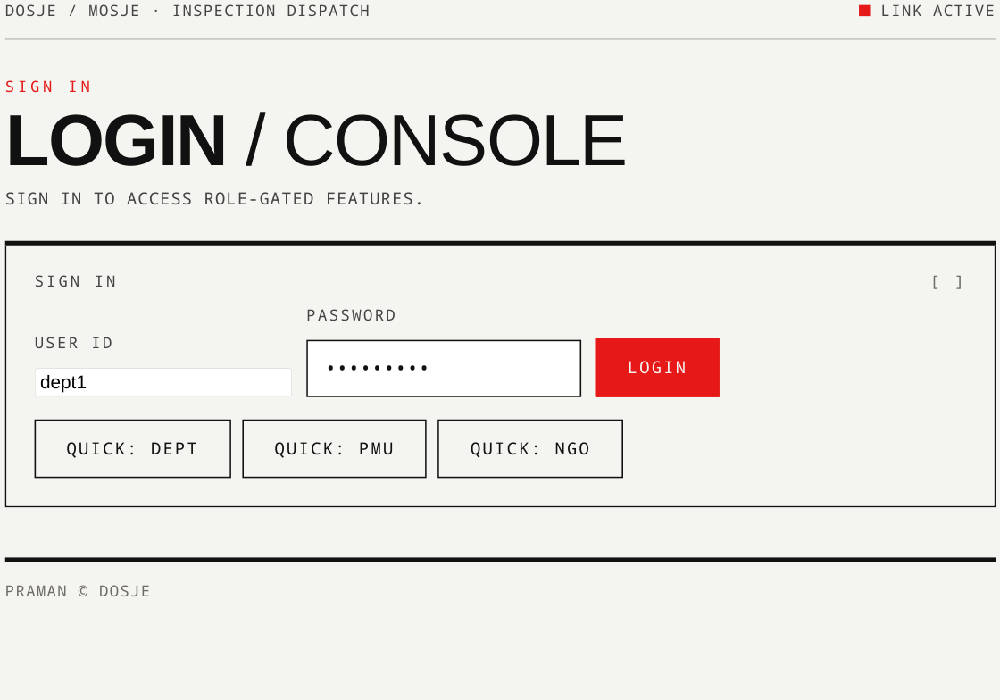
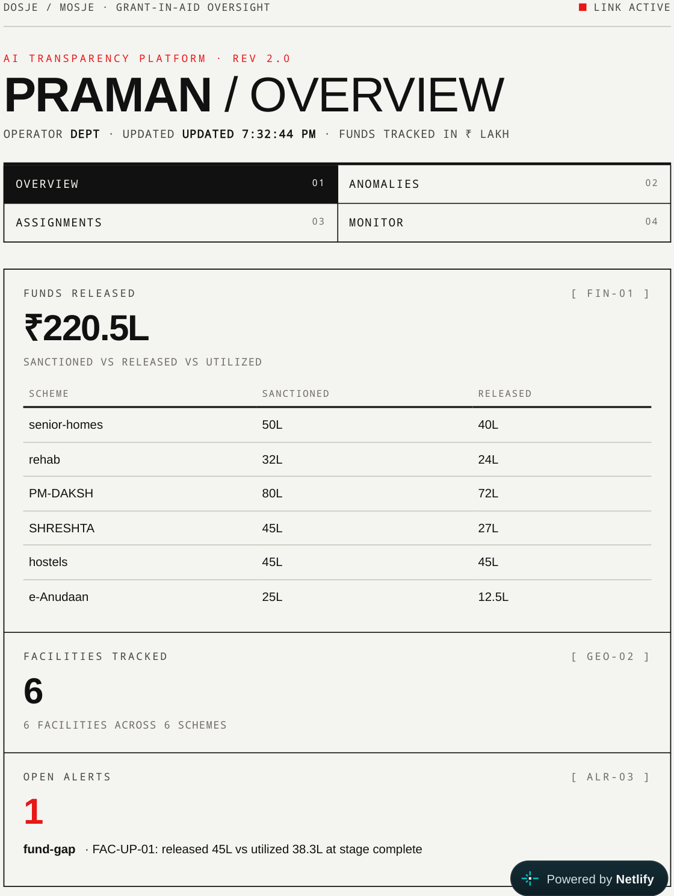
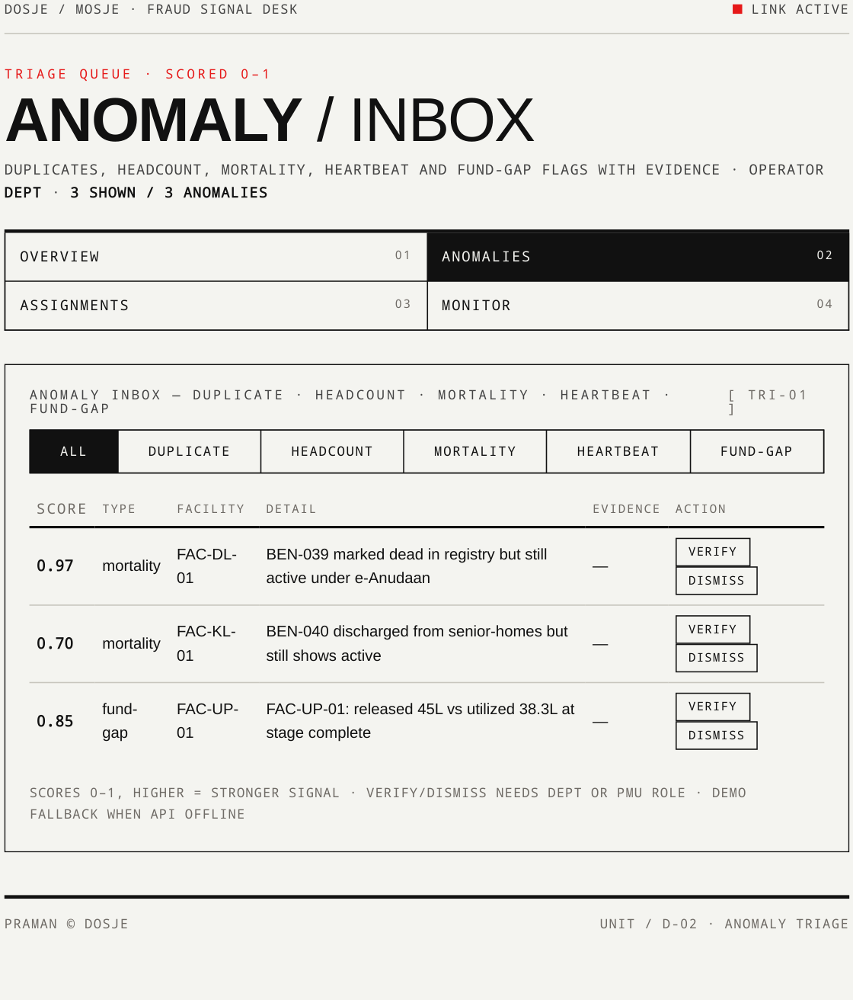
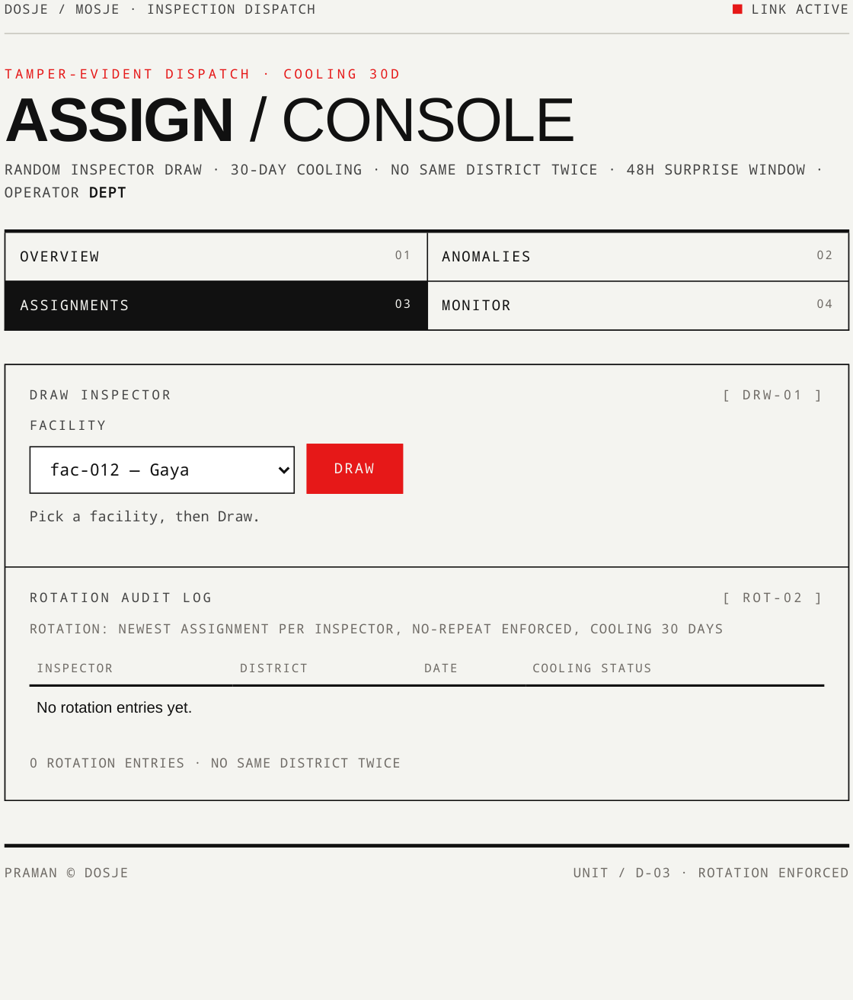
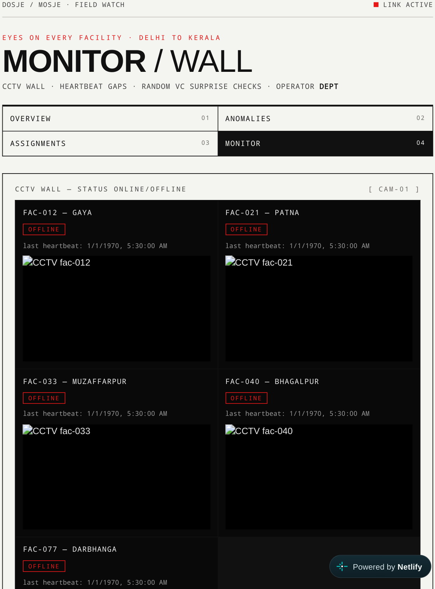
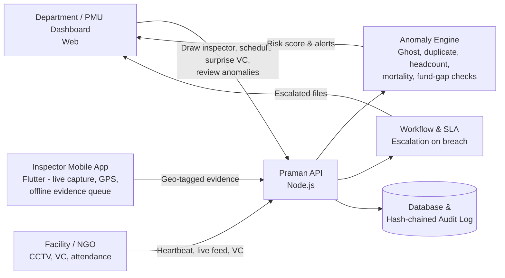

# PRAMAN — Smart Monitoring for a Transparent Tomorrow

> **Praman is a centralized, AI-powered monitoring and inspection platform that brings transparency and accountability to public welfare scheme implementation — tracking grant funds from release to ground-level use, verifying inspections with live evidence, and flagging fraud before payouts repeat.**

Built for the **Department of Social Justice and Empowerment (DoSJE), Ministry of Social Justice and Empowerment (MoSJE)**.

[](https://praman-sih-2026.netlify.app/app/login/page.html)


**🔗 Live Demo:** https://praman-sih-2026.netlify.app/app/login/page.html

---

## 📋 Problem Statement

| Item | Details |
|---|---|
| **Hackathon** | Smart India Hackathon 2026 |
| **Problem Statement ID** | SIH26095 |
| **Title** | Smart Real-Time Monitoring & Inspection Mobile App |
| **Theme** | Smart Automation |
| **Category** | Software |
| **Team** | Team Curiosity |

### The problem

Grant-in-Aid (GIA) welfare projects — de-addiction centres, senior citizen homes, hostels and other NGO-run facilities — are vulnerable to:

- Ghost beneficiaries and fake attendance reporting
- Inflated headcounts and recycled inspection photos
- GPS / media spoofing by field staff
- Inspector–NGO collusion and proxy functioning / proxy inspections
- Fund diversion — money released, but work not done on the ground

Manual audits are slow, predictable, and easy to game. Praman replaces them with continuous, evidence-based, zero-notice verification.

---

## ✨ Key Features

- **Real-time monitoring dashboard** — Live overview for Department officials: funds, facilities, inspections and alert counts in one place.
- **AI-based anomaly detection** — Flags ghost beneficiaries, duplicate evidence, headcount mismatches and fund gaps with a risk score.
- **Mobile inspection module** — For PMU / inspection teams: offline-first inspections with live-only camera capture and GPS tagging.
- **Random assignment of inspection duties** — Automated, bias-free inspector draw with district separation, no-repeat rules, 30-day cooling period and one-time tokens. No inspector picks their own site.
- **Geo-tagged inspection reports & live evidence** — Every photo is checked for GPS drift, clock drift and EXIF validity, hashed (SHA-256 + perceptual hash), and rejected if it is a gallery upload or a recycled image.
- **Live CCTV feed integration** — Facility camera registry with heartbeat monitoring; signed, short-lived stream URLs (5-minute TTL).
- **Random Video Conferencing (VC)** — Surprise, unannounced VC with the Project In-charge / staff / beneficiaries. Missed calls escalate automatically.
- **Fund-flow & SLA workflow** — Tracks a file through pending → approved → released, with automatic SLA-breach escalation to the next level.
- **Tamper-evident audit trail** — Every mutation appends a hash-chained audit log entry. Aadhaar and PII are masked in API responses, logs and list views.

---

## 📸 Screenshots

Captured from the [live demo](https://praman-sih-2026.netlify.app/app/login/page.html) on 23 October 2026.

### Login / Console — role-based sign-in with quick demo access (Dept / PMU / NGO)



### Overview Dashboard — funds released, facilities, scheme-wise grants and open alerts



### Anomaly Inbox — scored fraud signals (mortality, fund-gap, duplicate, headcount, heartbeat) with Verify / Dismiss



### Assign Console — random inspector draw with rotation audit log



### Monitor Wall — live CCTV tiles and surprise VC dialer



> Note: In the public demo, the CCTV tiles show **OFFLINE** because no live cameras or backend API are connected — the demo runs on fallback data. With a facility camera registered and the API running, the same tiles show the live feed and heartbeat status.

---

## 🚨 Fraud Matrix — What Praman Checks (P1–P5)

| ID | Fraud Class | How Praman Detects / Blocks It |
|----|-------------|--------------------------------|
| **P1** | Ghost beneficiaries | Beneficiary records cross-checked against duplicate `face_hash` signals and mortality / discharged registry status |
| **P2** | Recycled evidence | Perceptual-hash (`phash`) duplicate detection rejects photos resubmitted from previous years / inspections |
| **P3** | Spoofed location / media | Live-capture enforcement (no gallery uploads), GPS drift checks (OS vs. network), clock-drift checks and EXIF validation |
| **P4** | Collusion / proxy inspection | Random inspector draw, district no-repeat rule, 30-day cooling period, one-time inspection tokens and tamper-evident assignment logs |
| **P5** | Fund diversion / fund gap | Released vs. utilized amounts compared against physical stage and evidence (e.g. stage marked complete but BOQ / stage photo missing); SLA escalation holds the file |

**Schemes / facility types covered:** `PM-DAKSH`, `SHRESHTA`, `e-Anudaan`, senior citizen homes, rehabilitation / de-addiction centres, and hostels.

---

## 🏗️ How It Works



1. A grant / facility is registered and funds are tracked stage-wise.
2. The system **randomly draws an inspector** for a facility — with cooling and district-separation guardrails.
3. The inspector visits within a short window and captures **live, geo-tagged evidence** from the mobile app (gallery uploads are rejected).
4. The API validates evidence, runs **anomaly checks (P1–P5)** and scores the risk.
5. Officials review anomalies on the dashboard, can open **live CCTV** or launch a **surprise VC**, and advance / hold the fund file based on the outcome.
6. Every step is written to a **tamper-evident, hash-chained audit log**.

See the scripted walkthrough in [`docs/DEMO.md`](docs/DEMO.md).

---

## 🛠️ Tech Stack

### As implemented in this repository

| Layer | Technology |
|---|---|
| **API** | Node.js (≥ 22), native HTTP server, JWT auth (HS256, 15-min access + rotating refresh), role-based access (Dept / PMU / NGO) |
| **Web Dashboard** | Static web app in `web/` — funds, anomalies inbox, assignments, CCTV / VC monitor |
| **Mobile App** | Flutter (in `mobile/`) — Provider + GoRouter, live-only camera capture, OS GPS, offline evidence queue that syncs on reconnect |
| **Data** | Local database via `api/db/` (migrate + seed scripts), hash-chained audit log, HMAC-signed evidence |
| **Toolchain** | Node v22, Python 3.14 (verification harnesses), Flutter stable — see [`docs/TOOLCHAIN.md`](docs/TOOLCHAIN.md) |

### Proposed architecture in the SIH presentation

The presentation proposes the production scale-up stack:

| Layer | Proposed Technology |
|---|---|
| **Frontend (Web)** | React.js + Tailwind CSS |
| **Frontend (Mobile)** | React Native, Expo Camera (`expo-camera`) & Expo Location (`expo-location`) for geo-tagged reports |
| **Backend (Main API)** | Node.js + Express.js |
| **Database** | MongoDB (Mongoose) |
| **AI Engine** | Python + FastAPI — anomaly detection & random duty assignment |
| **Live CCTV** | RTSP (Real-Time Streaming Protocol) |
| **Video Conferencing** | WebRTC (media) + Socket.io (signalling) |

---

## 📁 Repository Structure

```text
PRAMAN_1/
├── api/          # Node API — auth, evidence, anomaly, assignment,
│                 #            monitor (CCTV/VC), workflow/SLA, db, seeds
├── web/          # Web dashboard — funds, anomalies inbox,
│                 #            assignments, CCTV/VC monitor
├── mobile/       # Flutter app — offline-first inspection,
│                 #            live capture, VC attendance
├── docs/         # API reference, demo script, runbook, toolchain pins
│   ├── API.md
│   ├── DEMO.md
│   ├── RUNBOOK.md
│   └── TOOLCHAIN.md
├── scripts/      # Node verifier harnesses (scripts/verify-*.mjs)
├── tests/        # Fixtures and end-to-end tests
└── package.json  # Root workspace scripts (api + web)
```

Detailed API documentation: [`docs/API.md`](docs/API.md) · Operations guide: [`docs/RUNBOOK.md`](docs/RUNBOOK.md)

---

## 🚀 Getting Started

### Prerequisites

- **Node.js ≥ 22**
- **Python 3.14** (for verification harnesses)
- **Flutter (stable)** — only required to build / run the mobile app

### 1. Clone the repository

```bash
git clone https://github.com/parshwa965/PRAMAN_1.git
cd PRAMAN_1
```

### 2. Run the API

```bash
npm run api:migrate   # create tables / schema (idempotent)
npm run api:seed      # load demo fixtures
npm run api:start     # API listens on http://localhost:3001
```

Run API tests:

```bash
npm run api:test
```

### 3. Run the Web Dashboard

```bash
npm run web:serve     # serves web on http://localhost:3000
```

Open `http://localhost:3000` and log in as a Department / PMU / NGO user (seeded demo users — see `docs/DEMO.md` / `docs/RUNBOOK.md`).

> The web and mobile clients expect the API at `:3001/api` — if the dashboard shows zeros, check that the API is running and reachable first.

### 4. Run the Mobile App (Flutter)

```bash
cd mobile
flutter pub get
flutter run
```

---

## ✅ Verification

```bash
node scripts/verify-1-1-1.mjs
node scripts/verify-1-1-1-toolchain.mjs
node scripts/verify-1-1-1-clean.mjs
```

General pattern for all harnesses:

```bash
node scripts/verify-*.mjs
```

---

## ⚠️ Challenges & How Praman Addresses Them

| Challenge | Mitigation |
|---|---|
| **Poor network in remote / rural facilities** impacting live video and uploads | Store-and-forward encrypted data sync (offline evidence queue) + adaptive WebRTC bitrate streaming for low-bandwidth environments |
| **GPS / media spoofing** — fake coordinates or pre-recorded gallery media | In-app live-camera locking (gallery uploads disabled), GPS drift checks, EXIF validation, perceptual-hash duplicate detection |

### Feasibility

- **Technical:** Built on proven, well-documented stacks for cross-platform access.
- **Operational:** Multi-tier rollout — pilot across **10–15 high-density NGO facilities** (e.g. de-addiction centres and senior citizen homes) before scaling pan-India.
- **Economic (prototype):** Low-cost MVP using open-source WebRTC, lightweight AI models and scalable cloud infrastructure. Preventing budget leakage yields a large operational ROI for the Ministry.

---

## 🌍 Impact & Benefits

- **For DoSJE Officials** — Replaces manual audits with zero-notice virtual checks, live CCTV access and real-time risk heatmaps.
- **For Beneficiaries** — Guarantees proper meals, beds and medical care in shelters / rehabs by eliminating proxy reporting.
- **For Honest NGOs & Institutes** — Less bureaucratic friction and faster Grant-in-Aid (GIA) fund disbursement.
- **For Field Inspectors** — A fair, bias-free workflow powered by automated, random inspection scheduling.
- **For Taxpayers** — An immutable, tamper-proof data trail for social welfare spending.

**Governance impact:** Stops fake attendance, ghost beneficiaries and inspector–NGO collusion — ensuring funds reach verified, operational facilities and restoring dignity and living standards for SC, senior citizen and transgender welfare scheme beneficiaries.

---

## 📚 Research & References

- **Ministry of Social Justice and Empowerment (DoSJE)** — Official guidelines, welfare schemes (NAPDDR, AVYAY, SHRESHTA) and administrative hierarchy — https://www.dosje.gov.in
- **e-Anudaan Portal** — Grants-in-Aid management system for NGO grant applications, tracking and compliance — https://grants-msje.gov.in
- **NGO-Darpan Portal (NITI Aayog & NIC)** — Registration, verification and unique ID tracking for voluntary organisations — https://ngodarpan.gov.in
- **Public Financial Management System (PFMS)** — Transparent, installment-based fund disbursement tracking — https://pfms.nic.in

---

## 👥 Team

**Team Curiosity** — Smart India Hackathon 2026

> *Praman: Smart monitoring for a transparent tomorrow.*

---

## 📄 License

This project was developed as a prototype for Smart India Hackathon 2026 (Problem Statement SIH26095). Please contact the team before reusing it for production / official use.
